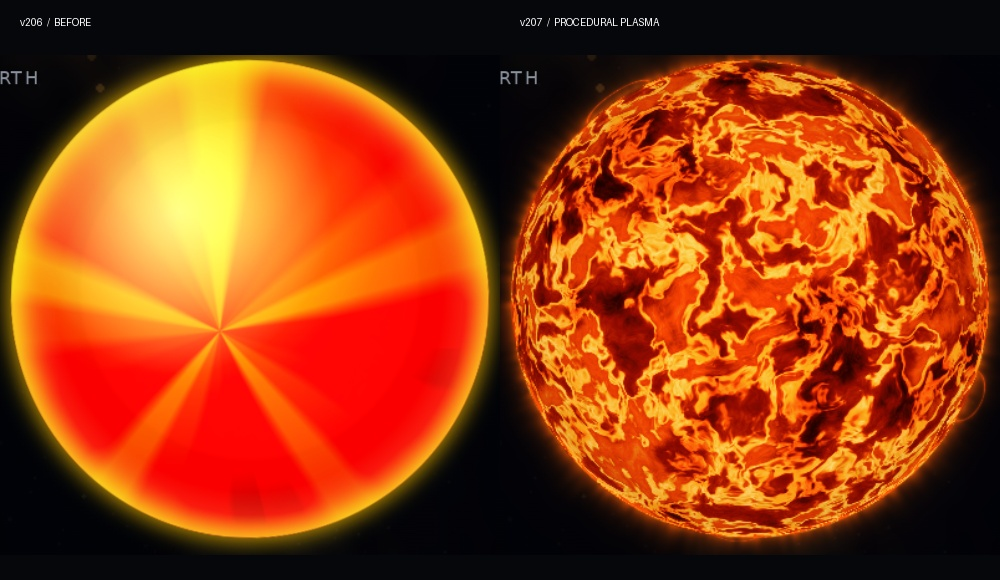

# COSMOS Sun v207 — procedural stellar plasma

v206の規則的な扇形を、赤黒いプラズマと金色に白熱するフィラメントが流動する太陽に置き換えた。表面・輪郭の光・小さなプロミネンスを一つのWebGLキャンバスで描く。

[公開版](https://thepatientagent.github.io/GPT-6-PAgt/?release=stellar-plasma-v207) · [実ツアーの検証動画（4秒 / MP4）](media/cosmos-sun-v207-tour.mp4) · [検証データ](cosmos-sun-v207-validation.json)

## 描画方式と整理

- WebGL 1 の単一パス。球面座標で3Dフラクタルノイズとドメインワーピングを計算する。時間とともに流れと形が変化し、静止画像の回転は使わない。
- 256×256のシード固定ノイズテクスチャを起動時に生成する。外部素材のダウンロード、毎フレームのCPUテクスチャ生成・GPUへの再転送は不要。
- 暗いプラズマ、橙色の中温域、黄金色の高温域を別々の温度帯として描く。穏やかな周縁減光で球体の奥行きを残す。
- 輪郭に連続する暖色の発光と、長さ・高さの異なる小さなアーチを同じシェーダー内で計算する。CSSの白いベール、放射状のトゲ、独立した光球、二重の光輪は使用しない。
- v190〜v206の重複する太陽CSS、疑似要素、白いベール、扇形レイヤー、親ページの旧CPU太陽描画を削除した。
- 既存の440pxローカル座標、中心220px、球体直径220px、拡大率・位置・不透明度・v206の描画順を維持する。太陽専用の追加RAFは作らず、既存の描画ループから更新する。
- 表示サイズに応じて解像度を段階的に調整する。上限は縦画面1024×1024、デスクトップ1536×1536。非表示時の太陽描画を止める。

## 実際に通過した検証

| 検証 | 結果 |
|---|---|
| Chromium・390×844・DPR 2・タッチ画面 | 全5地点の自動ツアー完走、太陽の描画エラー0 |
| Chromium・1440×900・DPR 1 | 全5地点の自動ツアー完走、太陽の描画エラー0 |
| WebKit / Safari 18.4系・390×844・DPR 2 | 全5地点の自動ツアー完走、WebGL太陽の描画エラー0 |
| ブラックホール→太陽系 | ブラックホールのiframeが解除され、余分なカーテンを残さず太陽系へ復帰 |
| 承認済み V13 Radiance | geometry=identity、radiance=source-synchronous、48フレーム準備済み、再生位相の進行を確認 |
| 表面の流動 | カメラ固定の0・1・6秒でも模様の変化を確認 |
| 動画 | 本来のツアーを時間制御して780×1688、4秒、30fpsで取得。120フレームすべて異なる |
| WebGLコンテキスト喪失・復帰 | Canvas2Dの代替表示に移行し、復帰後はWebGLへ戻る。復帰後も描画エラー0 |
| 動きを減らす設定 | 描画を静止状態に保つ |
| 既存コードとの照合 | カメラ移動・ツアー進行・BH切替・プレアデス・オリオン・銀河背景の対象関数が同一。惑星のCSSと太陽の投影式も同一 |

ブラウザー検証ではリポジトリの実ファイルをそのまま読み込み、既存ツアーを実行した。外部の地球素材は同じURLのデータを取得してテスト時に渡した。参考動画そのものや疑似アニメーションへの差し替えは行っていない。

## 未検証・残る制約

- 実物のiPhone上のSafari、Apple GPU、端末の発熱、長時間運転時のフレームレートは未測定。WebKitの検証はLinux上であり、iOS実機と同一ではない。
- 30fpsの検証動画は描画内容と連続性の確認用。端末の実測FPSを表さない。
- コンテナのSwiftShader（CPUによるソフトウェアGPU）で実ツアーの太陽系を実時間で計測した結果はv207が約14.5fps、v206が約21.7fps。iPhoneのハードウェアGPU性能とは比較できず、実機の滑らかさを保証する結果ではない。測定値は検証JSONに記録した。
- WebGLが利用できない場合は、表現力を抑えたCanvas2D代替表示になる。
- 太陽以外の演出は変更していない。既存の惑星素材・軌道表現の制約は本改修の対象外。

## 復旧と再検証

v206は [backup/cosmos-sun-v206-20261026](https://github.com/ThePatientAgent/GPT-6-PAgt/tree/backup/cosmos-sun-v206-20261026) に保存した。復旧基準コミットは `20740fa6389ec78f3065c5121e13d811a46c15d0`。

Playwrightを導入した環境で `node tools/cosmos-sun-v207-smoke.cjs --output cosmos-sun-qa` を実行できる。`--viewport desktop` で横画面、`COSMOS_BROWSER=webkit` でWebKit、`--record` で実ツアーの連続フレームを取得する。必要に応じてPlaywrightのモジュールとブラウザーのパスを環境変数で指定できる。
